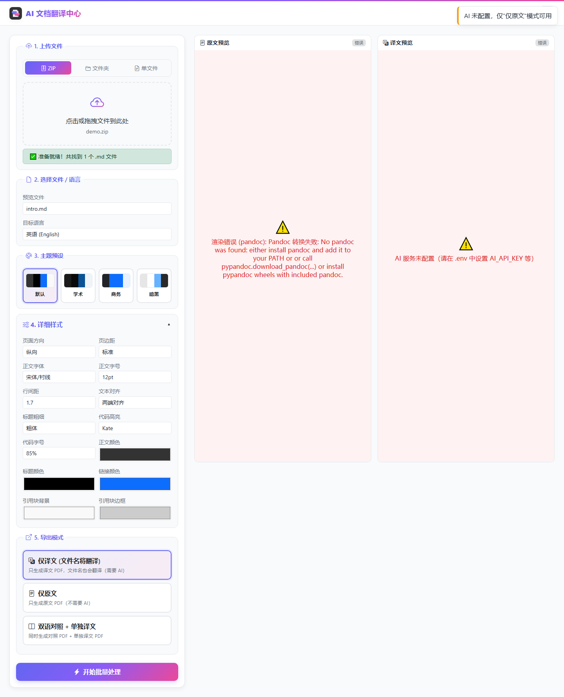
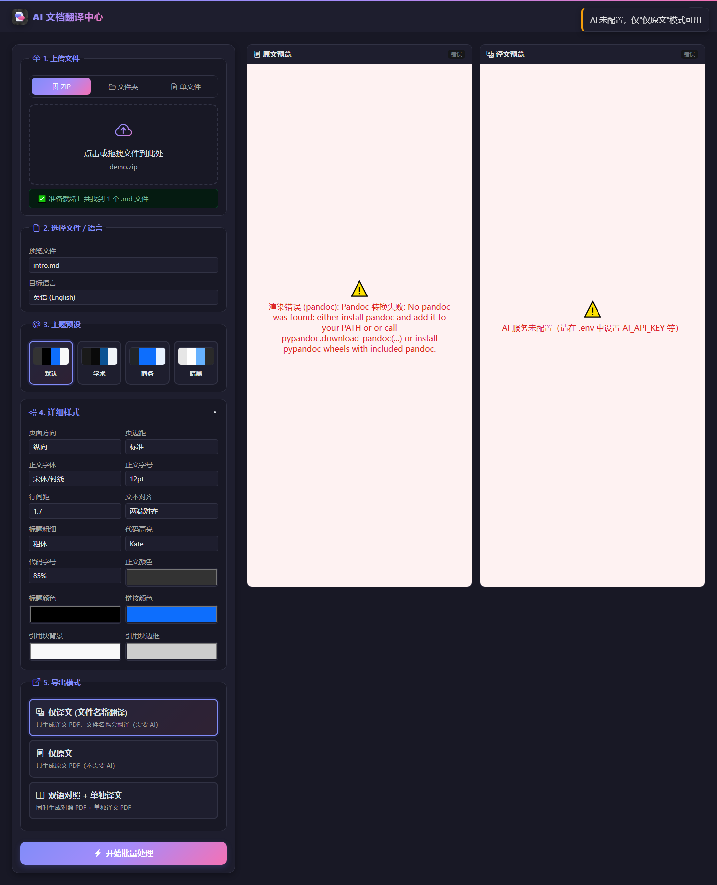

# AI 文档翻译中心

> 把 Markdown 批量翻译成多语言 PDF。零配置、开箱即用、支持双语对照。

[English](#english) · [中文](#中文)


---

## 中文

### ✨ 核心特性

- **批量翻译**：上传 ZIP / 文件夹 / 单个 `.md`，自动并发处理
- **多语言**：英 / 中 / 法 / 俄 / 西 / 阿，文件名也会翻译
- **三种导出模式**：仅原文 / 仅译文 / 双语对照（左右并排 PDF）
- **实时预览**：上传即可看到原文 + 译文 PDF
- **任务控制**：暂停 / 继续 / 结束，失败可重试
- **智能缓存**：相同内容不重复调用 AI，节省费用
- **路径安全**：防 zip slip、防路径遍历
- **主题预设**：默认 / 学术 / 商务 / 暗黑 + 自定义颜色
- **暗色模式**：随系统或手动切换
- **拖拽上传**：拖文件即可

### 📸 截图

| 浅色模式 | 暗色模式 |
|---|---|
|  |  |

### 🚀 快速开始

#### 方式一：Docker（推荐）

```bash
git clone https://github.com/<your-name>/markdown2pdf-trans.git
cd markdown2pdf-trans
cp .env.example .env       # 填入你的 AI_API_KEY 等
docker-compose up --build
```

打开 http://localhost:5000

#### 方式二：本地运行

```bash
# 1. 装 Python 依赖
pip install -r requirements.txt

# 2. 装系统依赖
# Windows: 下载 pandoc msi 安装；WeasyPrint 见下方说明
# macOS:   brew install pandoc
# Linux:   apt install pandoc libpango-1.0-0 libpangoft2-1.0-0

# 3. 配置 AI（不配只能用"仅原文"模式）
cp .env.example .env
# 编辑 .env，至少填入 AI_API_KEY

# 4. 启动
python -m src.app
```

打开 http://127.0.0.1:5000

### ⚙️ 配置

复制 `.env.example` 为 `.env`，按需修改：

| 变量 | 必填 | 默认 | 说明 |
|---|---|---|---|
| `AI_API_URL` | 翻译时 | - | OpenAI 兼容的 chat completions URL |
| `AI_API_KEY` | 翻译时 | - | 你的 API key |
| `AI_MODEL` | 翻译时 | - | 模型名（如 `gpt-4o-mini`） |
| `AI_TIMEOUT` | 否 | 180 | API 超时（秒） |
| `AI_MAX_RETRIES` | 否 | 3 | 失败重试次数 |
| `AI_MAX_CONCURRENCY` | 否 | 3 | AI 并发数 |
| `M2P_MAX_UPLOAD_MB` | 否 | 100 | 上传大小上限 |
| `M2P_OUTPUT_DIR` | 否 | `./output` | 任务输出目录 |
| `LOG_LEVEL` | 否 | INFO | 日志级别 |

### 📂 项目结构

```
markdown2pdf-trans/
├── src/                      # 源代码
│   ├── app.py                # Flask 入口（路由）
│   ├── config.py             # 环境变量 + 主题预设 + Prompt
│   ├── ai_client.py          # AI 客户端（限流 + 重试）
│   ├── translation_cache.py  # LRU + TTL 缓存
│   ├── task_manager.py       # 任务生命周期 + 状态机
│   ├── renderer.py           # MD → HTML → PDF
│   ├── uploads.py            # 上传 + ZIP 解压（路径安全）
│   ├── biligual_align.py     # 双语对照结构化分块
│   ├── conversion.py         # 转换工作线程
│   ├── concurrency.py        # 信号量 + 重试装饰器
│   ├── file_utils.py         # 文件工具
│   ├── static/               # logo / favicon
│   └── templates/
│       └── index.html        # UI 模板
├── tests/                    # 38 个测试用例
├── img/                      # 截图 + 品牌资产
├── Docker/
│   └── Dockerfile            # 镜像构建
├── .env.example              # 环境变量模板
├── .gitignore
├── requirements.txt          # 运行时依赖
├── requirements-dev.txt      # 开发依赖（含测试）
├── LICENSE
├── CHANGELOG.md
└── README.md
```

### 🔌 API

| 端点 | 方法 | 说明 |
|---|---|---|
| `/` | GET | Web UI |
| `/ai_status` | GET | AI 服务配置状态 |
| `/prepare_upload` | POST | 上传文件，返回 task_id |
| `/preview/original` | POST | 原文 PDF 预览（返回 PDF + X-Page-Count） |
| `/preview/translated` | POST | 译文 PDF 预览 |
| `/start_conversion` | POST | 启动批量转换 |
| `/pause/<task_id>` | POST | 暂停任务 |
| `/resume/<task_id>` | POST | 恢复任务 |
| `/stop/<task_id>` | POST | 停止任务 |
| `/status/<task_id>` | GET | 轮询状态 + 日志 + current_file |
| `/download/<task_id>` | GET | 下载结果 ZIP |

### ❓ 常见问题

**Q: Pandoc 报错 "No pandoc was found"？**
A: 这是系统依赖，需要单独装：https://pandoc.org/installing.html

**Q: WeasyPrint 报 "libgobject-2.0-0" 找不到？**
A: WeasyPrint 需要 GTK 运行时。Windows 用户建议用 Docker 跑，或参考 https://doc.courtbouillon.org/weasyprint/stable/first_steps.html#installation。Linux 用 `apt install libpango-1.0-0 libpangoft2-1.0-0`。

**Q: AI 没配置也能用吗？**
A: 可以，**仅原文模式**不依赖 AI。

**Q: 翻译费用高吗？**
A: 翻译有缓存，相同内容只调一次 AI。可在 `.env` 调整 `AI_MAX_CONCURRENCY` 控制并发。

**Q: 支持哪些大模型？**
A: 任何兼容 OpenAI Chat Completions 协议的服务：OpenAI、Azure OpenAI、DeepSeek、Anthropic（通过代理）、本地 Ollama（通过 one-api 代理）等。

### 🧪 测试

```bash
pip install -r requirements-dev.txt
pytest tests/ -v
```

38 个测试覆盖：缓存、文件读取、分块对齐、路径安全、上传大小、状态机、限流、重试、端到端流程。

### 📦 部署建议

- **个人/小团队**：直接 Docker compose
- **生产环境**：建议 nginx + gunicorn + systemd
- **持久化**：将 `output/` 目录挂载到卷
- **清理**：任务目录 1 天后自动清理，可在 `.env` 调整 `M2P_TASK_TTL_SECONDS`

### 📄 License

Apache 2.0

### ⚠️ 免责声明

本项目仅供学习和研究使用。使用者需：
- 遵守相关法律法规
- 尊重知识产权
- 不得用于商业用途
- 对使用本软件产生的任何后果自行承担责任

---

## English

A Flask-based web service that converts Markdown to PDF with AI-powered multi-language translation.

### Features

- Batch translation of Markdown files (ZIP / folder / single file)
- 6 languages: English, Chinese, French, Russian, Spanish, Arabic
- Three export modes: original / translated / bilingual side-by-side
- Live PDF preview before conversion
- Task control: pause / resume / stop / retry
- Translation cache (LRU + TTL) saves API cost
- Path safety: zip slip & traversal blocked
- 4 theme presets + custom colors
- Dark mode (auto / manual)
- Drag & drop upload

### Quick Start

```bash
git clone https://github.com/<your-name>/markdown2pdf-trans.git
cd markdown2pdf-trans
cp .env.example .env       # fill in your AI_API_KEY
docker-compose up --build  # or: pip install -r requirements.txt && python -m src.app
```

Open http://localhost:5000

### API

See [Chinese section above](#-api) for full endpoint list.

### License

Apache 2.0

### Disclaimer

For learning and research only. Users must comply with applicable laws, respect intellectual property, and bear all responsibility for outcomes.
